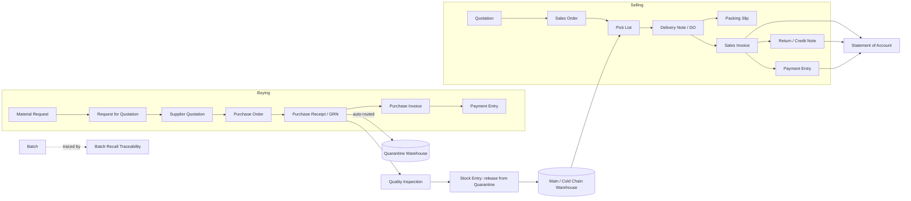

# Kodessy ERP - User Guide

For day-to-day users of the Kodessy pharmaceutical import and distribution system.
This guide lists every DocType that is in use, **why it is needed**, **how the system fulfils that need**
and **which other documents it connects to**.

Site: https://pharma-demo-kodessy.frappe.cloud

---

## 1. The big picture

Every approval, submit and cancel on the main documents creates a **notification** for the next approver role
and the document owner, and a line in the document's **timeline** ("Notification sent to ...").

### Roles

| Role | Typical user | Main powers |
|---|---|---|
| Sales User | Sales executive | Create quotations / orders, submit for approval |
| Sales Manager | Sales head | Approve quotations and sales orders |
| Purchase User | Buyer | Create POs, submit for approval |
| Purchase Manager | Purchasing head | Approve PO tier 1 |
| Accounts Manager | Finance | Approve PO tier 2, approve credit notes, invoices and payments |
| Stock User / Manager | Warehouse | Receive, pick, deliver, count stock |
| Quality Unit | QA | Record inspections, **release stock from Quarantine** |
| System Manager | IT / admin | Everything (also allowed to release stock) |

---

## 2. Master data DocTypes

| DocType | Why it is needed | How it is fulfilled | Linked to |
|---|---|---|---|
| **Customer** | Hospitals and clinics we sell to; each has a credit ceiling | Field **Credit Limit** (`custom_credit_limit`, MYR). Seeded: Gleneagles 100,000; Sunway 50,000; Klinik Mediviron 15,000 | Quotation, Sales Order, Sales Invoice, Payment Entry, Statement of Account |
| **Supplier** | Overseas and local pharma suppliers | Standard supplier with **Supplier Group** (Pharmaceutical Supplier, Local Distributor) | Purchase Order, Purchase Receipt, Purchase Invoice |
| **Supplier Group** | Needed for tax rules and PO creation | Created automatically at migrate | Supplier |
| **Item** | Pharmaceutical, medical device and veterinary products | Extra fields: **Product Category**, **Pack Size** (mandatory), **Storage Condition** (ambient / 2-8C / frozen), **Registration No.**, **Requires QC Release**. Batch and expiry tracking on; shelf life default 730 days | Every transaction line; Batch; Quality Inspection |
| **Batch** | Lot number with expiry for traceability and recall | Fields: expiry date, **Recalled**, **Recall Reason**, **Near Expiry**. Teal **View Traceability** button on the form | Purchase Receipt, Delivery Note, Stock Entry, Pick List, Quality Inspection, Traceability report |
| **Warehouse** | Physical and logical stock locations | Main (ambient), Cold Chain (2-8C), **Quarantine**, Near-Expiry Bin, Finished Goods, Goods In Transit, Stores | Bin, all stock documents |
| **UOM** | Box, Pack, Vial, Bottle, Pen, Unit, Nos | Created at migrate; each demo item has its stock UOM in its UOM table | Item, transaction lines |
| **Quality Inspection Template / Parameter** | Standard incoming checks | Template with 5 parameters: appearance, packaging integrity, label and batch, CoA present, temperature on arrival | Quality Inspection |
| **Role** (Quality Unit) | Separates QA authority from stock handling | Created at migrate | Stock Entry release rule, reports, notifications |

---

## 3. Sales DocTypes

### 3.1 Quotation (`QTR-YYYY-####`)
- **Requirement:** create quotations with internal approval; convert approved ones into sales orders.
- **How:** workflow **Quotation Approval Workflow**: Draft -> Pending Sales Manager Approval -> Approved (or Rejected). Only an Approved quotation can be converted (**Create -> Sales Order**).
- **Credit check:** if customer exposure would exceed the limit, an orange **alert** is shown (the quotation can still be saved).
- **Linked to:** Customer (party), Item lines; creates Sales Order.

### 3.2 Sales Order (`SO-YYYY-####`)
- **Requirement:** confirmed customer order; blocked when credit limit exceeded; never allocates unsellable stock.
- **How:**
  - Approval workflow (review -> forward -> final approve) before it is confirmed.
  - **Credit control:** exposure = open invoice balances + this order. Over the limit the save is **blocked** unless an authorised user is entered in **Credit Override Approved By**; the order then saves with a warning.
  - **Quarantine control:** lines from Quarantine / Near-Expiry / Reject warehouses, expired batches and recalled batches are rejected.
- **Linked to:** Quotation (source), Customer, Pick List, Delivery Note, Sales Invoice, Backorder report.

### 3.3 Pick List (`PCK-YYYY-####`) and Packing Slip
- **Requirement:** picking and packing slips from confirmed orders with quantities and batches.
- **How:** **Create -> Pick List** from the Sales Order. Batches are allocated by earliest expiry (FEFO). Print with **Pharma Pick and Pack Slip** (item, storage zone, batch, expiry, three sign-offs: picked, QA verified, driver hand-off). Quarantined stock is blocked here too.
- **Packing Slip:** create from a **draft** Delivery Note (ERPNext rule).
- **Linked to:** Sales Order, Delivery Note, Batch, Warehouse.

### 3.4 Delivery Note / Delivery Order (`DO-YYYY-####`)
- **Requirement:** delivery orders and partial deliveries with accurate quantity tracking.
- **How:** **Create -> Delivery Note** from the Sales Order and reduce quantities for a partial delivery (e.g. 6 of 10 gives 60% delivered; the rest shows as backorder). Empty batches are filled automatically with the **earliest-expiry** batch that has stock. Fields **Delivery Type** and **Dispatch Temperature** feed the **Pharma Delivery Order** print (registration no., batch, expiry, customer receiving block).
- **Linked to:** Sales Order, Pick List, Sales Invoice, Batch, Stock Ledger.

### 3.5 Sales Invoice (`SINV-YYYY-####`)
- **Requirement:** invoices from sales orders / deliveries; returns and credit notes with approval.
- **How:** **Create -> Sales Invoice** from the Delivery Note. For returns, tick return (or **Create -> Return / Credit Note**): each line needs **Return Reason** (damaged in transit, quality/defective batch, wrong delivery, near expiry, ...) and **QA Assessment Status** (pending inspection, accepted - quarantine and scrap, accepted - return to saleable stock, ...). A credit note must be approved with **Approve Credit Note** by an Accounts / Finance Manager (not its creator) before submit; changing the amount cancels the approval.
- **Linked to:** Delivery Note, Sales Order, Customer, Payment Entry, Batch, Statement of Account.

### 3.6 Payment Entry (`PAY-YYYY-####`)
- **Requirement:** record customer receipts and supplier payments; reduce outstanding balance (which lifts credit headroom).
- **Linked to:** Sales Invoice / Purchase Invoice, Customer / Supplier, Journal Entry (accounting).

---

## 4. Procurement DocTypes

| DocType | Why | How | Linked to |
|---|---|---|---|
| **Material Request** (`MR-`) | Internal request to buy stock | Standard; can generate RFQ or PO | Purchase Order, Item |
| **Request for Quotation** (`RFQ-`) / **Supplier Quotation** (`SQ-`) | Compare supplier prices | Standard ERPNext flow | Supplier, Purchase Order |
| **Purchase Order** (`PUR-`) | Order from suppliers with two-tier approval, status and lead time | Workflow **Purchase Order Two-Tier Approval**: Draft -> Pending Purchasing Manager Approval -> (Approve Tier 1) -> Pending Finance Approval -> (Approve Tier 2) -> Approved. **Required By** date gives lead time; status (To Receive and Bill) and % received show outstanding deliveries | Supplier, Item, Purchase Receipt, Purchase Invoice, Backorder and Inbound Supply report |
| **Purchase Receipt / GRN** (`GRN-`) | Record incoming shipments with batch and expiry | Create from the PO. Lines for items flagged **Requires QC Release** are **moved automatically to the Quarantine warehouse**. Enter batch and expiry per line; inspection is required before submit | Purchase Order, Quality Inspection, Batch, Warehouse, Purchase Invoice |
| **Purchase Invoice** (`PINV-`) | Supplier billing | Create from the receipt / PO | Purchase Receipt, Payment Entry |

---

## 5. Warehouse and quality DocTypes

| DocType | Why | How | Linked to |
|---|---|---|---|
| **Quality Inspection** (`QI-`) | Incoming quality check before stock can be sold | Reference the Purchase Receipt, select item and batch, apply the template, set Accepted / Rejected, submit | Purchase Receipt, Batch, Item |
| **Stock Entry** (`STE-`) | Move stock; **release from Quarantine** | Entry type Material Transfer from Quarantine to Main / Cold Chain. Only **Quality Unit, Quality Manager or System Manager** can do this - others are blocked | Warehouse, Batch, Quality Inspection |
| **Stock Reconciliation** (`SRC-`) | Physical stock count and discrepancy | Enter counted quantity per item / warehouse / batch; the form shows system quantity versus counted and the value difference; submit to post the adjustment (workflow approval on the site) | Warehouse, Batch, Item |
| **Bin / Stock Ledger** | Real-time stock | Stock Balance and Stock Ledger reports, per batch, expiry and warehouse | All stock documents |

### Stock rules in plain words
1. Anything received that needs QC lands in **Quarantine**. It cannot be sold, picked or delivered from there.
2. After inspection, the **Quality Unit** moves it to a saleable warehouse with a Stock Entry.
3. **Expired**, **recalled** and **Near-Expiry/Reject-warehouse** stock is blocked on Sales Order, Pick List, Delivery Note and Sales Invoice.
4. When no batch is chosen, delivery takes the **earliest expiry first (FEFO)**.
5. A daily job marks batches expiring within **90 days** as Near Expiry and creates a task for Stock Managers.

---

## 6. Finance and reports

| Report / DocType | Why | How to use | Based on |
|---|---|---|---|
| **Statement of Account** (General Ledger and Accounts Receivable) | Show a customer invoices, credit notes, payments and balance for a period | Open General Ledger, choose company, dates, Party Type Customer, the party; or Accounts Receivable for ageing | Sales Invoice, Credit Note, Payment Entry, Journal Entry |
| **Journal Entry** (`JV-`) | Manual accounting entries | Standard | General Ledger |
| **Backorder and Inbound Supply** | Unfulfilled customer orders, outstanding quantity, expected stock arrival | Reports workspace: shows ordered, delivered, backorder, on-hand, shortfall, inbound quantity, expected arrival and PO numbers | Sales Order, Delivery Note, Purchase Order, Bin |
| **Batch Recall Traceability** | Trace a batch from supplier receipt to customer delivery | From a Batch click **View Traceability**, or open the report and enter the batch | Purchase Receipt, Quality Inspection, Stock Ledger, Delivery Note, Sales Invoice, Customer |

**Audit trail:** open any document -> Activity / Timeline shows every version change, workflow action, approval comment and notification.

---

## 7. Notifications and activity (new)

For these DocTypes: Quotation, Sales Order, Purchase Order, Stock Reconciliation, Payment Entry, Journal Entry, Customer, Supplier, Item, Internal Store Request, Payment Request, Delivery Note, Sales Invoice, Purchase Receipt, Purchase Invoice, Stock Entry, Quality Inspection, Pick List.

| Event | Who is notified (bell icon) | What appears in the timeline |
|---|---|---|
| Workflow stage changes | Users holding the role that can act next, plus the document owner | `Notification sent to <Role>` followed by the document, new stage and who did it; plus `Notification sent to Owner` |
| Submitted | Approver roles of the workflow (or Stock / Accounts / Quality managers by document type) and the owner | Same pattern with "submitted" |
| Cancelled | Same | Same pattern with "cancelled" |

The person who performed the action is not sent a bell notification for it.

---

## 8. How documents link - quick reference

| From | Action | To | What carries over |
|---|---|---|---|
| Material Request | Create | Request for Quotation / Purchase Order | Items, quantities |
| Supplier Quotation | Create | Purchase Order | Prices |
| Purchase Order | Create | Purchase Receipt | Items, supplier, quantities |
| Purchase Receipt | Reference | Quality Inspection | Item, batch |
| Purchase Receipt | Create | Purchase Invoice | Items, amounts |
| Quarantine stock | Stock Entry | Main / Cold Chain | Batch, quantity |
| Quotation | Create | Sales Order | Customer, items, prices |
| Sales Order | Create | Pick List | Items, warehouse |
| Sales Order | Create | Delivery Note | Items, remaining quantity |
| Delivery Note | Create | Packing Slip (draft DN) / Sales Invoice | Items, batches |
| Sales Invoice | Return / Credit Note | Sales Invoice (is return) | Items, reason, assessment |
| Sales / Purchase Invoice | Payment | Payment Entry | Outstanding amount |
| Any batch | Trace | Batch Recall Traceability | Receipt -> QC -> delivery -> customer |

---

## 9. Naming series

QTR (Quotation), SO (Sales Order), PCK (Pick List), DO (Delivery Note), SINV (Sales Invoice), MR (Material Request), RFQ, SQ (Supplier Quotation), PUR (Purchase Order), GRN (Purchase Receipt), PINV (Purchase Invoice), STE (Stock Entry), SRC (Stock Reconciliation), QI (Quality Inspection), PAY (Payment Entry), JV (Journal Entry). Format `PREFIX-YYYY-####`, e.g. `PUR-2026-0001`.

---

## 10. Walk-through: one product from order to payment

1. **Buyer** creates a Purchase Order for AMOX-500 -> Submit for Approval.
2. **Purchase Manager** approves tier 1; **Accounts Manager** approves tier 2 -> PO Approved (notifications at each step).
3. **Warehouse** creates the Purchase Receipt with batch and expiry -> stock lands in **Quarantine**.
4. **Quality Unit** records the Quality Inspection and moves the stock to Main with a Stock Entry.
5. **Sales** creates a Quotation for a hospital -> Sales Manager approves -> Sales Order (credit limit checked) -> final approval.
6. **Warehouse** makes the Pick List (earliest expiry first) and prints the Pick and Pack Slip.
7. Delivery Note (full or partial) -> print the Delivery Order.
8. **Finance** creates the Sales Invoice from the Delivery Note.
9. If goods come back: Sales Invoice return with reason and assessment -> **Accounts Manager approves** the credit note -> submit.
10. Customer pays -> Payment Entry -> **Statement of Account** shows invoices, credit notes, payments and balance.
11. If a batch is recalled: tick **Recalled** on the Batch (it is now blocked everywhere) and use **View Traceability** to list every customer who received it.

## 11. Known limits

- A Packing Slip can only be created from a draft Delivery Note.
- Return validation (reason and assessment) is under re-test; do not rely on it until the next release note says it is confirmed.
- Near-expiry threshold is 90 days until the client confirms the policy.
- Barcode scanning and mobile / handheld devices are not part of this release.
